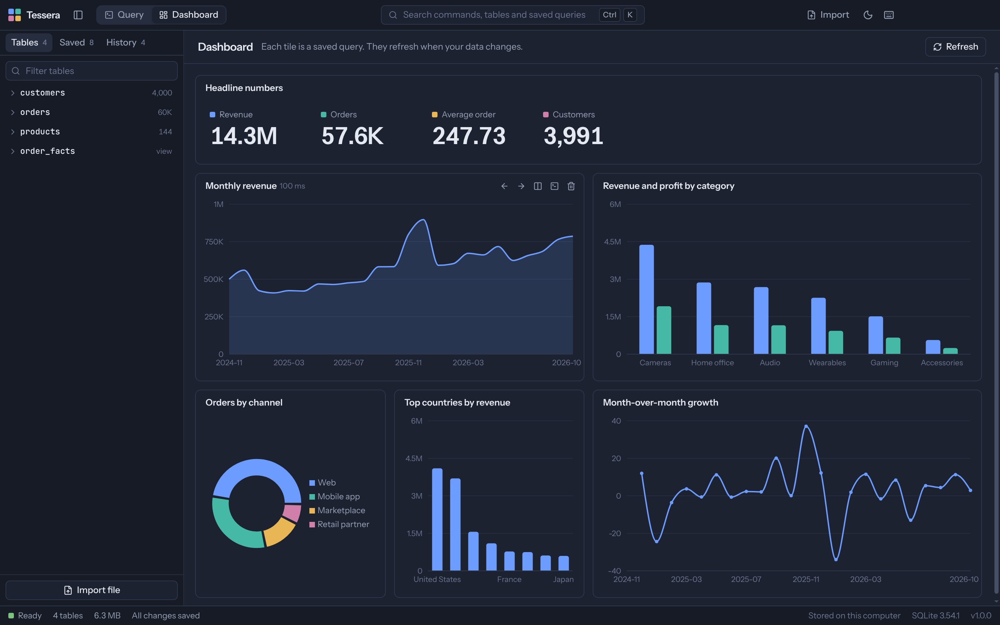
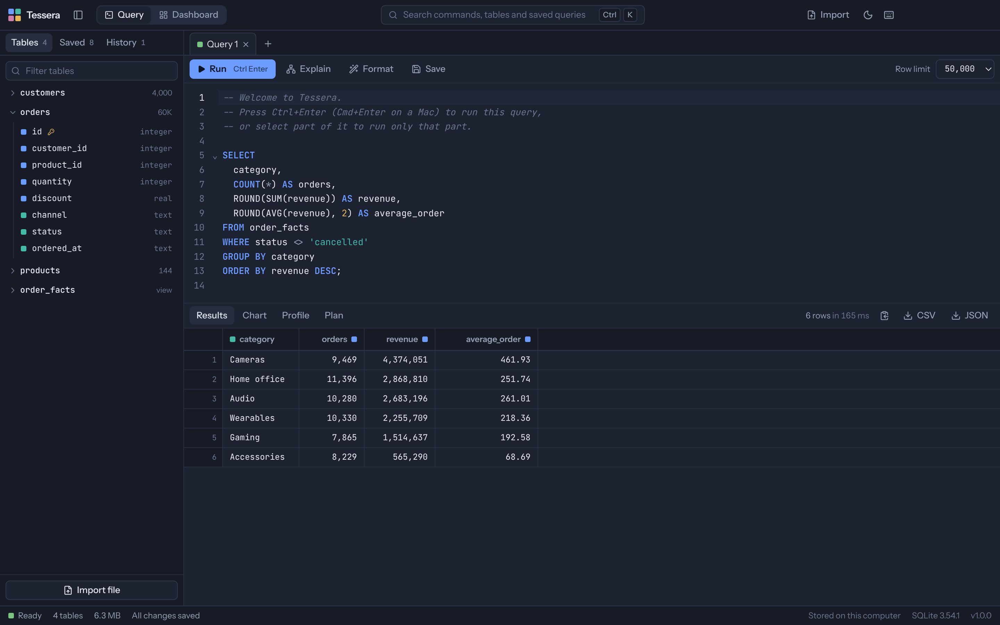
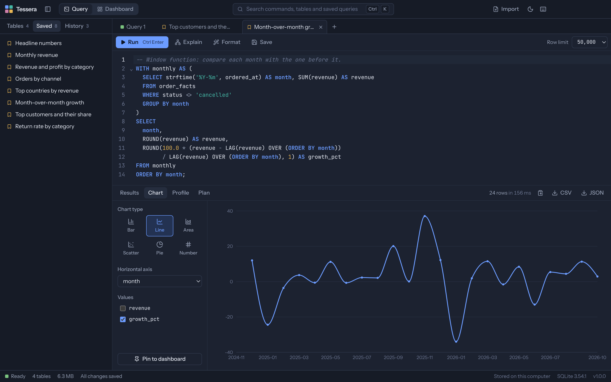
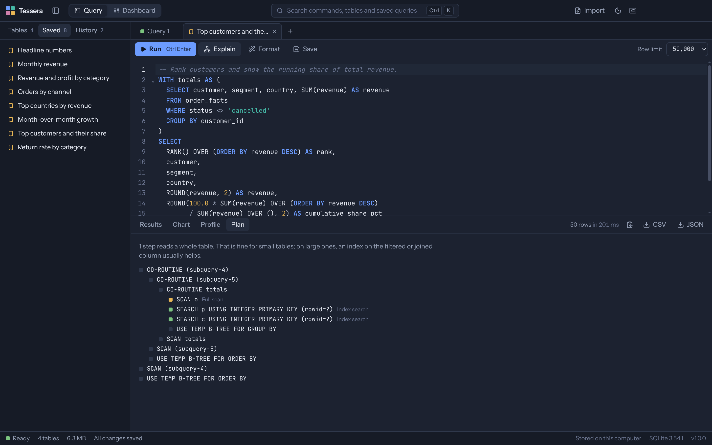
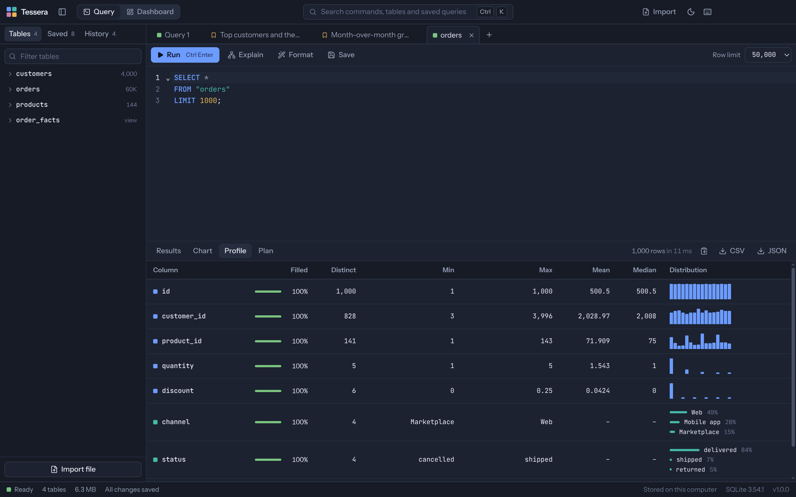
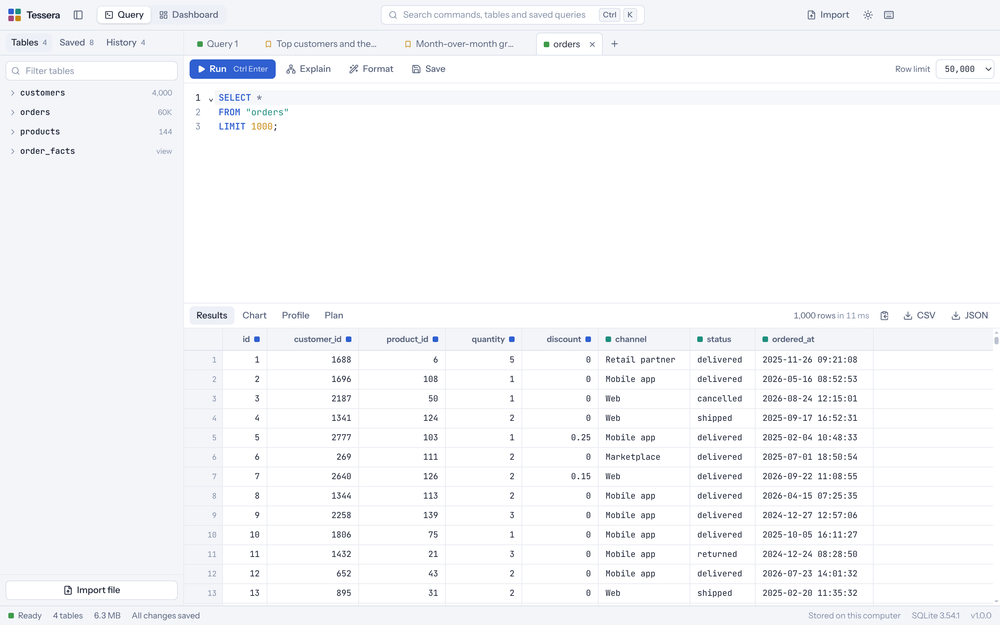
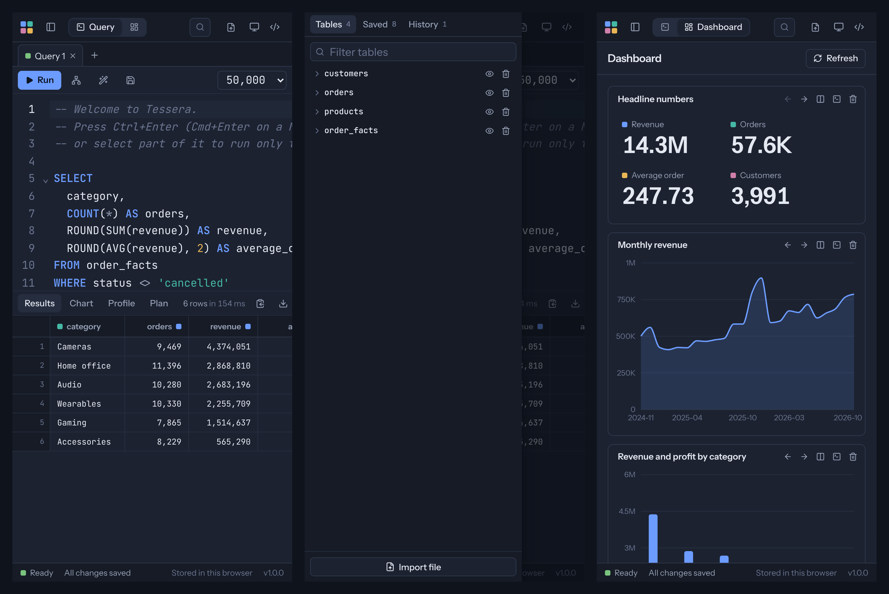
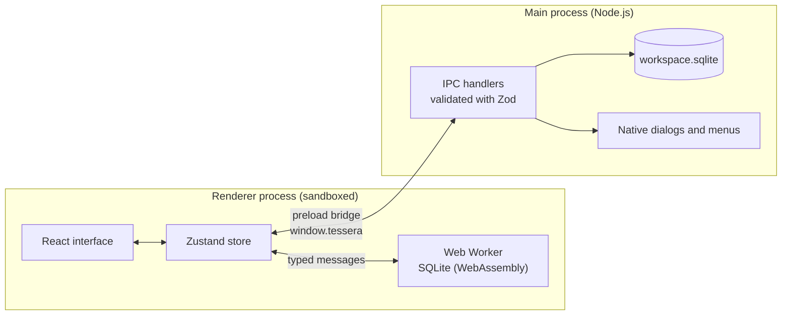

# Tessera

A local-first SQL workbench that runs as a desktop app and as a website. Drop in a CSV, JSON or SQLite file, query it with real SQL, chart the result and pin it to a dashboard. Nothing leaves your machine.

[](https://github.com/mohdaktham/tessera/actions/workflows/ci.yml)
[](https://github.com/mohdaktham/tessera/releases)
[](LICENSE)



**[Download for Windows, macOS or Linux](https://github.com/mohdaktham/tessera/releases)** · **[Open it in your browser](https://tesserasql.vercel.app)**

## What it does

**Bring data in**

- Import CSV, TSV, JSON and newline-delimited JSON by file picker or drag and drop
- Column types are inferred from the data (and codes like `00123` are kept as text)
- Open an existing SQLite database, or export the whole workspace as one
- One click loads a 60,000-order sample dataset, so there is something to explore straight away

**Query it**

- A full SQL editor with syntax highlighting, autocomplete that knows your tables and columns, multiple tabs and per-tab undo history
- SQLite 3 with CTEs, window functions and JSON functions
- Run the whole query or only the selected text; stop a runaway query at any time
- Results appear in a virtualised grid that stays smooth at 200,000 rows, with sorting, column resizing, keyboard navigation and copy
- Explain shows the query plan as a tree and flags full table scans
- Profile summarises every column: completeness, distinct values, range, mean, median and a histogram

**Share what you find**

- Turn any result into a bar, line, area, scatter or pie chart, or a row of headline numbers
- Pin charts to a dashboard that re-runs its queries whenever the data changes
- Export results as CSV or JSON, or copy them as a Markdown table
- Save queries by name; every run is kept in history with its duration

**Work fast**

- Command palette (`Ctrl/Cmd+K`) with fuzzy search over every action, table and saved query
- Keyboard shortcuts for everything, light and dark themes, resizable panes
- The workspace saves itself and is restored on the next launch

| Query editor and results                         | Charts                                            |
| ------------------------------------------------ | ------------------------------------------------- |
|  |  |

| Query plan                                    | Column profile                                       | Light theme                                      |
| --------------------------------------------- | ---------------------------------------------------- | ------------------------------------------------ |
|  |  |  |

The website adapts to phones: the sidebar becomes a drawer and the toolbars collapse to icons.



## Built with

| Area          | Technology                                                                     |
| ------------- | ------------------------------------------------------------------------------ |
| Language      | TypeScript in strict mode, across all three processes                          |
| Desktop shell | Electron (sandboxed renderer, context isolation, typed IPC)                    |
| Interface     | React 19, Tailwind CSS 4, Zustand, CodeMirror 6, Recharts, TanStack Virtual    |
| Database      | SQLite compiled to WebAssembly (sql.js), running in a Web Worker               |
| Validation    | Zod schemas on every message that crosses the process boundary                 |
| Build         | Vite, electron-vite, electron-builder                                          |
| Tests         | Vitest and Testing Library for units and components, Playwright for end-to-end |
| Quality       | ESLint, Prettier, GitHub Actions on Windows, macOS and Linux                   |

## How it is put together



A few decisions shape the whole codebase:

- **SQL runs off the UI thread.** SQLite lives in a Web Worker, so a heavy query or a large import never freezes the window. The interface talks to it through a small promise-based client with typed requests and progress events.
- **The renderer is treated as untrusted.** It has no Node.js access. A preload script exposes seven functions, and the main process validates every argument with Zod and checks which frame sent it before doing anything.
- **One codebase, two hosts.** A thin platform layer hides whether the app is inside Electron or a plain browser. That is what lets the same code ship as a website, and it keeps the interface testable without launching Electron.
- **Logic is kept out of components.** Type inference, CSV parsing, fuzzy matching, chart shaping, sorting and profiling are pure functions in `src/renderer/src/lib`, each with unit tests.

[docs/ARCHITECTURE.md](docs/ARCHITECTURE.md) goes deeper into each of these, including the trade-offs.

## Run it locally

You need [Node.js 22](https://nodejs.org) or newer.

```bash
git clone https://github.com/mohdaktham/tessera.git
cd tessera
npm install
npm run dev          # desktop app with hot reload
```

Other useful commands:

| Command            | What it does                                               |
| ------------------ | ---------------------------------------------------------- |
| `npm run dev:web`  | Runs the website version in a browser, without Electron    |
| `npm run check`    | Typecheck, lint and unit tests                             |
| `npm run test:e2e` | Builds the app and drives it with Playwright               |
| `npm run test:web` | Builds the website and tests it at desktop and phone sizes |
| `npm run dist`     | Builds an installer for the operating system you are on    |

Installers are written to `release/`. Pushing a tag such as `v1.0.0` runs the release workflow, which builds for Windows, macOS and Linux and attaches the files to a GitHub Release.

## Deploy the website

The website is a static build, so it needs no server. The repository includes a `vercel.json`, which means [Vercel](https://vercel.com) needs no settings:

1. Sign in to Vercel with GitHub and choose **Add New → Project**.
2. Import this repository and press **Deploy**.

Every push to `main` then redeploys the site, and every pull request gets its own preview link. `vercel.json` sets the build command, the output folder and the response headers: a strict Content-Security-Policy (the same one the desktop app uses), clickjacking and MIME-sniffing protection, and long-lived caching for hashed assets.

To try the production build locally with those same headers, run `npm run build:web` and then `npm run preview:web`.

## Keyboard shortcuts

On macOS, use `Cmd` in place of `Ctrl`. A browser keeps `Ctrl+T`, `Ctrl+W` and the number keys for itself, so on the website those four use `Alt` instead (`Alt+T`, `Alt+W`, `Alt+1`, `Alt+2`).

| Shortcut            | Action                                   |
| ------------------- | ---------------------------------------- |
| `Ctrl+Enter`        | Run the query, or only the selected text |
| `Ctrl+Shift+Enter`  | Explain the query plan                   |
| `Ctrl+K`            | Command palette                          |
| `Ctrl+S`            | Save the query                           |
| `Ctrl+Shift+F`      | Format the SQL                           |
| `Ctrl+T` / `Ctrl+W` | New tab / close tab                      |
| `Ctrl+O`            | Import a file                            |
| `Ctrl+1` / `Ctrl+2` | Query editor / dashboard                 |
| `Ctrl+B`            | Toggle the sidebar                       |
| `Ctrl+Shift+L`      | Switch between light and dark            |
| `Ctrl+/`            | Show all shortcuts                       |

## Project layout

```
src/
  main/        Electron main process: window, menu, IPC handlers, app:// protocol, storage
  preload/     The bridge exposed to the page as window.tessera
  shared/      The IPC contract: channel names, Zod schemas and types used by both sides
  renderer/src/
    engine/    SQLite engine, the worker that hosts it, and the client that talks to it
    lib/       Pure functions: inference, parsing, fuzzy search, charts, profiling, exports
    store/     Zustand stores for workspace state and settings
    components/  React components
    platform/  Desktop and browser implementations of the same interface
tests/e2e/     Playwright tests that launch the built app
```

## Testing

- **Unit and component tests** (`npm test`) cover the engine against a real SQLite build, plus every function in `lib` and the IPC schemas.
- **End-to-end tests** (`npm run test:e2e`) launch the packaged app and check the full path: load data, run SQL, handle an error, chart and pin a result, import a CSV, and confirm the workspace survives a restart. They also assert that the page cannot reach Node.js.
- **Website tests** (`npm run test:web`) run the site in a browser at a desktop and a phone size, behind the same response headers Vercel sends. They check the headers, the core flow, that the workspace survives a reload, and the phone layout, and they fail on any Content-Security-Policy violation.
- **CI** runs all of it on every push, on all three operating systems.

## Security

- Renderer runs with `sandbox: true`, `contextIsolation: true` and `nodeIntegration: false`
- A strict Content-Security-Policy with no remote or inline scripts
- The app is served from a private `app://` scheme with path-traversal protection
- All IPC input is validated; file writes only go where the user chooses in a native dialog
- Navigation, new windows, webviews and permission requests are all denied
- No network requests, analytics or telemetry of any kind

## Known limits

- The database is held in memory, so the practical ceiling is a few hundred megabytes of data. A native SQLite binding would lift this at the cost of per-platform builds.
- Stopping a query restarts the engine from the last save, so changes made in the half second before stopping can be lost.
- The installers are not code-signed. Windows SmartScreen and macOS Gatekeeper will warn on first launch.

## License

[MIT](LICENSE)
